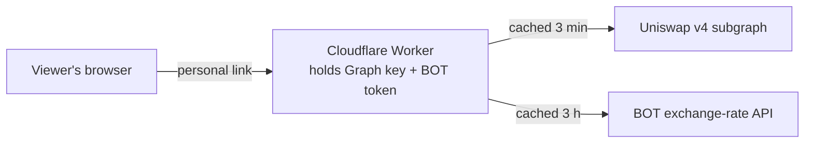

# Shared Price Deviation Dashboard

A separate, shareable version of `dashboard.html` for an internal audience. Viewers open the dashboard and see live rates without needing a Graph API key or BOT token, because the dashboard uses yours from the server side.

The original `dashboard.html` on GitHub Pages is unchanged and still works with your own keys.

## How it works



- **One Cloudflare Worker** serves the page (`public/index.html`) and one JSON endpoint, `/api/rates`. Your Graph key and BOT token are stored as Worker secrets and never reach a browser.
- **The Worker checks every request** before serving anything, and refuses everything until a sign-in mode is set up. There are two modes (set `AUTH_MODE` in `wrangler.toml`):
  - **`link` (default): personal links.** Each person or team gets their own link. You can turn any one off without affecting the others. No sign-in, no admin approval.
  - **`access`: emailed one-time code** through Cloudflare Access. Viewers type their work email and get a code. Only addresses you allow can get in.
- **Shared cache:** pool prices are fetched at most every 3 minutes and BOT rates every 3 hours, whatever the number of viewers. With 50 people watching, API usage is the same as for one.
- **Same calculation as `dashboard.html`:** deviation thresholds (red > 4%, yellow > 2%), BOT rate selection, pool fallback and THBT orientation are unchanged.

### Which mode to choose

| | Personal links (`link`) | Emailed code (`access`) |
|---|---|---|
| What viewers do | Click the link once; the browser remembers it | Enter work email, then a code (about once a day) |
| Who can get in | Anyone holding a link | Only email addresses you allow |
| If a link or email is forwarded | The recipient gets in, until you turn that link off | Codes go only to the allowed inbox |
| Turning someone off | Remove their line from `VIEWER_LINKS` | Remove them from the Access policy |
| Setup | About 15 minutes, all in this Worker | About 30 minutes, plus Cloudflare Zero Trust |

Personal links are the quickest. If the dashboard should only ever be seen by named colleagues, the emailed code is stricter.

## Files

| File | Purpose |
|---|---|
| `src/worker.js` | Sign-in checks, data fetching, caching and the deviation calculation |
| `public/index.html` | The dashboard page (no settings or keys) |
| `scripts/new-link.mjs` | Creates a personal link (link mode) |
| `wrangler.toml` | Worker configuration |

## Setup

### 1. Deploy the Worker from this repo

1. In the Cloudflare dashboard, go to **Workers & Pages → Create → Import a repository**.
2. Pick `jamesliew-abc/uniswap-lp-price`, and under **Advanced settings** set the **root directory** to `shared-dashboard`.
3. Deploy. The Worker is called `thbt-deviation-dashboard`, and every push to `main` redeploys it.

Prefer the command line? From this folder: `npx wrangler login`, then `npx wrangler deploy`.

### 2. Add your keys as secrets

Worker → **Settings → Variables and Secrets → Add**, type **Secret**:

| Name | Value |
|---|---|
| `GRAPH_API_KEY` | Your The Graph API key |
| `BOT_API_TOKEN` | Your BOT API token, exactly as you paste it into the current dashboard |

Secrets survive redeploys. You don't need the BOT proxy Worker for this version; this Worker calls BOT directly.

### 3. Shared cache

Already set up: `wrangler.toml` points at the `RATES_CACHE` KV namespace.

### 4A. Personal links (`AUTH_MODE = "link"`, the default)

1. Create a link for each person or team. From this folder, with Node installed:

   ```
   node scripts/new-link.mjs "Somchai (Treasury)" https://thbt-deviation-dashboard.<your-subdomain>.workers.dev
   ```

   It prints a line such as `Somchai (Treasury):_qToF7SVCQt9ZlsHbS4tA6BOhIbII3dz` and the matching link. No Node? Any password generator works: use 32 random letters and digits as the token.
2. Add a secret called **`VIEWER_LINKS`** holding one `name:token` line per person, for example:

   ```
   Somchai (Treasury):_qToF7SVCQt9ZlsHbS4tA6BOhIbII3dz
   Ops team:Xw3k9...
   ```

   Names can't contain `:` or `,`. Tokens shorter than 24 characters are ignored.
3. Send each person their link privately, for example in a direct message rather than a group channel.

The first time someone opens their link, the dashboard remembers it in their browser and removes it from the address bar. After that, the plain dashboard URL works for them. The header shows the name from their line ("Signed in as Somchai (Treasury)").

### 4B. Emailed one-time code (`AUTH_MODE = "access"`)

This uses Cloudflare Access with its built-in one-time PIN. It doesn't need Google Workspace or any admin approval: Cloudflare emails each viewer a code.

1. Open **Zero Trust** in the Cloudflare dashboard. The first time, it asks you to choose a team name, which gives you a team domain such as `yourteam.cloudflareaccess.com`. The Free plan covers up to 50 users, though Cloudflare may ask for a payment card when you activate it.
2. Worker → **Settings → Domains & Routes**. Next to `workers.dev`, choose **Enable Cloudflare Access**. Copy the **AUD tag** and **team domain** the dialog shows.
3. Choose **Manage Cloudflare Access** and edit the application:
   - **Policy:** Allow, Include **Emails ending in** `@yourcompany.com`, or **Emails** to list specific people.
   - **Login methods:** One-time PIN.
4. Set these in `wrangler.toml` and commit:

   ```toml
   AUTH_MODE = "access"
   ACCESS_TEAM_DOMAIN = "yourteam.cloudflareaccess.com"
   ACCESS_AUD = "the AUD tag you copied"
   ALLOWED_EMAIL_DOMAIN = "yourcompany.com"
   ```

   Set these in `wrangler.toml`, not in the dashboard: each deploy replaces dashboard values with what's in this file. None of them are secret.

If your company's email filter holds the code emails, ask IT to allow mail from `noreply@notify.cloudflare.com`.

### 5. Check it

- **Links:** open your own link in a private window and confirm you see live rates. Then change one character of the token and confirm you get "This link isn't valid".
- **Emailed code:** open the `workers.dev` URL in a private window, enter your work email, and confirm the code arrives and the dashboard loads. Then try a personal address and confirm Access blocks it.

## Day to day

- **Adding someone (links):** run `scripts/new-link.mjs`, add the line to `VIEWER_LINKS`, send the link. Updating the secret doesn't need a redeploy.
- **Removing someone (links):** delete their line from `VIEWER_LINKS`. Their link and remembered browser stop working within seconds. If a link might have been forwarded, replace it with a new one.
- **Adding or removing someone (emailed code):** change the Access policy in Zero Trust.
- **Rotating a key:** update the secret in the Worker's settings. It takes effect within seconds.
- **Changing pools or thresholds:** edit `PAIRS` or `DEVIATION_RED` / `DEVIATION_YELLOW` in `src/worker.js` and push to `main`. Keep `dashboard.html` in step if you change the rules.
- **Local testing:** `npx wrangler dev --var ALLOW_UNAUTHENTICATED:true` with a `.dev.vars` file holding the two keys. Never set `ALLOW_UNAUTHENTICATED` on the deployed Worker.

## Limitations

- **Links can be forwarded.** Anyone holding a working link can open the dashboard, so treat links like passwords and give one per person, so you can turn off just that one. If the dashboard should be limited to named people with no exceptions, use the emailed code instead.
- **Remembered links last a year** in that browser, unless you turn the link off first. Clearing browser data means opening the original link again.
- **Emailed-code sign-ins** last for the Access session length you choose (24 hours by default). When a session ends, the page shows "Sign in again".
- Like `dashboard.html`, the page only refreshes while someone has it open. Alerts when nobody is watching would need a scheduled job.
- GitHub Pages also publishes this folder because it deploys the whole repo, but the copy there holds no keys and shows nothing without the Worker behind it.
