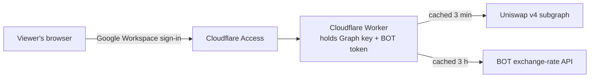

# Shared Price Deviation Dashboard

A separate, shareable version of `dashboard.html` for an internal audience. Viewers sign in with their company **Google Workspace** account and see live rates. They don't need a Graph API key or BOT token, because the dashboard uses yours from the server side.

The original `dashboard.html` on GitHub Pages is unchanged and still works with your own keys.

## How it works



- **One Cloudflare Worker** serves the page (`public/index.html`) and one JSON endpoint, `/api/rates`. Your Graph key and BOT token are stored as Worker secrets and never reach a browser.
- **Cloudflare Access** puts a Google Workspace sign-in in front of the whole Worker. The Worker also checks the Access sign-in token itself on every request, so it refuses everything if Access is ever switched off or misconfigured.
- **Shared cache:** pool prices are fetched at most every 3 minutes and BOT rates every 3 hours, whatever the number of viewers. With 50 people watching, API usage is the same as for one.
- **Same calculation as `dashboard.html`:** deviation thresholds (red > 4%, yellow > 2%), BOT rate selection, pool fallback and THBT orientation are unchanged.

## Files

| File | Purpose |
|---|---|
| `src/worker.js` | Access token check, data fetching, caching and the deviation calculation |
| `public/index.html` | The dashboard page (no settings or keys) |
| `wrangler.toml` | Worker configuration |

## Setup (one-off, about 30 minutes)

You need a free Cloudflare account and Google Workspace admin help for step 4 if you can't create OAuth clients yourself.

### 1. Deploy the Worker from this repo

1. In the Cloudflare dashboard, go to **Workers & Pages → Create → Import a repository**.
2. Pick `jamesliew-abc/uniswap-lp-price`, and under **Advanced settings** set the **root directory** to `shared-dashboard`.
3. Deploy. The Worker is called `thbt-deviation-dashboard`, and every push to `main` redeploys it.

Until step 5 is done, the Worker refuses every request with "This dashboard is not set up yet". That's expected.

Prefer the command line? From this folder: `npx wrangler login`, then `npx wrangler deploy`.

### 2. Add your keys as secrets

Worker → **Settings → Variables and Secrets → Add**, type **Secret**:

| Name | Value |
|---|---|
| `GRAPH_API_KEY` | Your The Graph API key |
| `BOT_API_TOKEN` | Your BOT API token, exactly as you paste it into the current dashboard |

Secrets survive redeploys. You don't need the BOT proxy Worker for this version; this Worker calls BOT directly.

### 3. Recommended: add the shared cache

Without it, each Cloudflare location keeps its own cache, which is fine for a small team but uses more API calls.

1. **Storage & Databases → Workers KV → Create**, name it `RATES_CACHE`.
2. In `wrangler.toml`, uncomment the `[[kv_namespaces]]` block and paste the namespace ID.

### 4. Add Google Workspace as the sign-in method

1. Open **Zero Trust** in the Cloudflare dashboard. The first time, it asks you to choose a team name, which gives you a team domain such as `yourteam.cloudflareaccess.com`. The Free plan covers up to 50 users.
2. Go to **Settings → Authentication → Login methods → Add new → Google Workspace**, and follow [Cloudflare's Google Workspace guide](https://developers.cloudflare.com/cloudflare-one/identity/idp-integration/gsuite/). In short: create an OAuth client in Google Cloud with the redirect URI `https://<your-team>.cloudflareaccess.com/cdn-cgi/access/callback`, then paste its client ID, secret and your Workspace domain into Cloudflare.
3. Use **Test** to confirm you can sign in.

### 5. Put Access in front of the Worker

1. Worker → **Settings → Domains & Routes**. Next to `workers.dev`, choose **Enable Cloudflare Access**.
2. The dialog shows the **AUD tag** and **team domain**. Copy both.
3. Choose **Manage Cloudflare Access** and edit the application:
   - **Policy:** Allow, Include **Emails ending in** `@yourcompany.com` (or a Google Workspace group, if you'd rather name specific people).
   - **Login methods:** Google Workspace only, and turn off one-time PIN.
4. Fill in `wrangler.toml` and commit:

   ```toml
   ACCESS_TEAM_DOMAIN = "yourteam.cloudflareaccess.com"
   ACCESS_AUD = "the AUD tag you copied"
   ALLOWED_EMAIL_DOMAIN = "yourcompany.com"
   ```

   Set these in `wrangler.toml`, not in the dashboard: each deploy replaces dashboard values with what's in this file. None of them are secret.

### 6. Check it

1. Open the Worker's `workers.dev` URL in a private window. You should be sent to Google sign-in, then see the dashboard with "Signed in as …" in the header.
2. Try a personal Gmail account. Access should block it.
3. Share the URL with your team.

## Day to day

- **Adding or removing people:** change the Access policy in Zero Trust. Nothing in this repo changes.
- **Rotating a key:** update the secret in the Worker's settings. It takes effect immediately.
- **Changing pools or thresholds:** edit `PAIRS` or `DEVIATION_RED` / `DEVIATION_YELLOW` in `src/worker.js` and push to `main`. Keep `dashboard.html` in step if you change the rules.
- **Local testing:** `npx wrangler dev --var ALLOW_UNAUTHENTICATED:true` with a `.dev.vars` file holding the two keys. Never set `ALLOW_UNAUTHENTICATED` on the deployed Worker.

## Limitations

- Sign-ins last for the Access session length you choose (24 hours by default). When a session ends, the page shows "Sign in again".
- Like `dashboard.html`, it only refreshes while someone has it open. Alerts when nobody is watching would need a scheduled job.
- GitHub Pages also publishes this folder because it deploys the whole repo, but the copy there holds no keys and shows nothing without the Worker behind it.
