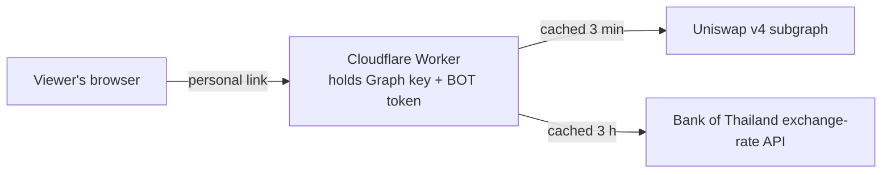
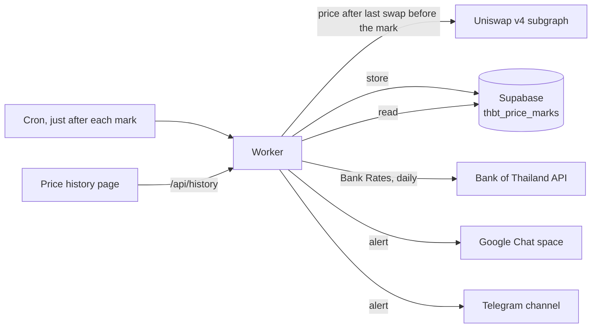

# Shared Price Deviation Dashboard

A separate, shareable version of `dashboard.html` for an internal audience. Viewers open the dashboard and see live rates without needing a Graph API key or Bank of Thailand (BOT) API token, because the dashboard uses yours from the server side.

The original `dashboard.html` on GitHub Pages is unchanged and still works with your own keys.

## How it works



- **One Cloudflare Worker** serves the page (`public/index.html`) and one JSON endpoint, `/api/rates`. Your Graph key and BOT token are stored as Worker secrets and never reach a browser.
- **The Worker checks every request** before serving anything, and refuses everything until a sign-in mode is set up. There are two modes (set `AUTH_MODE` in `wrangler.toml`):
  - **`link` (default): personal links.** Each person or team gets their own link. You can turn any one off without affecting the others. No sign-in, no admin approval.
  - **`access`: emailed one-time code** through Cloudflare Access. Viewers type their work email and get a code. Only addresses you allow can get in.
- **Shared cache:** pool prices are fetched at most every 3 minutes and Bank Rates every 3 hours, whatever the number of viewers. With 50 people watching, API usage is the same as for one.
- **Same calculation as `dashboard.html`:** deviation thresholds (red > 4%, yellow > 2%), Bank Rate selection, pool fallback and THBT orientation are unchanged.

### Which mode to choose

| | Personal links (`link`) | Emailed code (`access`) |
|---|---|---|
| What viewers do | Click the link once; the browser remembers it | Enter work email, then a code (about once a day) |
| Who can get in | Anyone holding a link | Only email addresses you allow |
| If a link or email is forwarded | The recipient gets in, until you turn that link off | Codes go only to the allowed inbox |
| Turning someone off | Remove their line from `VIEWER_LINKS` | Remove them from the Access policy |
| Setup | About 15 minutes, all in this Worker | About 30 minutes, plus Cloudflare Zero Trust |

Personal links are the quickest. If the dashboard should only ever be seen by named colleagues, the emailed code is stricter.

## Files

| File | Purpose |
|---|---|
| `src/worker.js` | Sign-in checks, data fetching, caching and the deviation calculation |
| `public/index.html` | The Live rates page (no settings or keys) |
| `public/history.html` | The Price history page |
| `public/theme.css` | Shared orange theme for both pages |
| `src/history.js` | 6-hourly capture, 90-day backfill, Bank Rate history, alerts (Google Chat, Telegram) and the history API |
| `public/history.html`, `public/deviation.html` | Price history and Deviation history pages (shared code in `history-page.js` and `history.css`) |
| `scripts/telegram-setup.mjs` | Finds your Telegram channel's chat ID and sends a test message |
| `supabase/migrations/` | The Supabase tables, for reference (already applied) |
| `scripts/new-link.mjs` | Creates a personal link (link mode) |
| `wrangler.toml` | Worker configuration |

## Setup

### 1. Deploy the Worker from this repo

1. In the Cloudflare dashboard, go to **Workers & Pages → Create → Import a repository**.
2. Pick `jamesliew-abc/uniswap-lp-price`, and under **Advanced settings** set the **root directory** to `shared-dashboard`.
3. Deploy. The Worker is called `thbt-deviation-dashboard`, and every push to `main` redeploys it.

Prefer the command line? From this folder: `npx wrangler login`, then `npx wrangler deploy`.

### 2. Add your keys as secrets

Worker → **Settings → Variables and Secrets → Add**, type **Secret**:

| Name | Value |
|---|---|
| `GRAPH_API_KEY` | Your The Graph API key |
| `BOT_API_TOKEN` | Your BOT API token, exactly as you paste it into the current dashboard |

Secrets survive redeploys. You don't need the BOT proxy Worker for this version; this Worker calls BOT directly.

### 3. Shared cache

Already set up: `wrangler.toml` points at the `RATES_CACHE` KV namespace.

### 4A. Personal links (`AUTH_MODE = "link"`, the default)

1. Create a link for each person or team. From this folder, with Node installed:

   ```
   node scripts/new-link.mjs "Somchai (Treasury)" https://thbt-deviation-dashboard.<your-subdomain>.workers.dev
   ```

   It prints a line such as `Somchai (Treasury):_qToF7SVCQt9ZlsHbS4tA6BOhIbII3dz` and the matching link. No Node? Any password generator works: use 32 random letters and digits as the token.
2. Add a secret called **`VIEWER_LINKS`** holding one `name:token` line per person, for example:

   ```
   Somchai (Treasury):_qToF7SVCQt9ZlsHbS4tA6BOhIbII3dz
   Ops team:Xw3k9...
   ```

   Names can't contain `:` or `,`. Tokens shorter than 24 characters are ignored.
3. Send each person their link privately, for example in a direct message rather than a group channel.

The first time someone opens their link, the dashboard remembers it in their browser and removes it from the address bar. After that, the plain dashboard URL works for them. The header shows the name from their line ("Signed in as Somchai (Treasury)").

### 4B. Emailed one-time code (`AUTH_MODE = "access"`)

This uses Cloudflare Access with its built-in one-time PIN. It doesn't need Google Workspace or any admin approval: Cloudflare emails each viewer a code.

1. Open **Zero Trust** in the Cloudflare dashboard. The first time, it asks you to choose a team name, which gives you a team domain such as `yourteam.cloudflareaccess.com`. The Free plan covers up to 50 users, though Cloudflare may ask for a payment card when you activate it.
2. Worker → **Settings → Domains & Routes**. Next to `workers.dev`, choose **Enable Cloudflare Access**. Copy the **AUD tag** and **team domain** the dialog shows.
3. Choose **Manage Cloudflare Access** and edit the application:
   - **Policy:** Allow, Include **Emails ending in** `@yourcompany.com`, or **Emails** to list specific people.
   - **Login methods:** One-time PIN.
4. Set these in `wrangler.toml` and commit:

   ```toml
   AUTH_MODE = "access"
   ACCESS_TEAM_DOMAIN = "yourteam.cloudflareaccess.com"
   ACCESS_AUD = "the AUD tag you copied"
   ALLOWED_EMAIL_DOMAIN = "yourcompany.com"
   ```

   Set these in `wrangler.toml`, not in the dashboard: each deploy replaces dashboard values with what's in this file. None of them are secret.

If your company's email filter holds the code emails, ask IT to allow mail from `noreply@notify.cloudflare.com`.

### 5. Check it

- **Links:** open your own link in a private window and confirm you see live rates. Then change one character of the token and confirm you get "This link isn't valid".
- **Emailed code:** open the `workers.dev` URL in a private window, enter your work email, and confirm the code arrives and the dashboard loads. Then try a personal address and confirm Access blocks it.

## Price history, deviation history and alerts

**Bank Rate** throughout the dashboard means the Bank of Thailand's Daily Average Exchange Rate mid rate.

The **Price history** page shows each pair's THBT price at fixed 6-hour marks: **03:00, 09:00, 15:00 and 21:00 Bangkok time**. It opens on the last 7 days, with quick switches for 1, 2 and 3 days and a custom range of up to 90 days.

The **Deviation history** page uses the same captures and date ranges, but shows each pair's deviation from the Bank Rate at each mark. Dashed lines mark ±2% and ±4%, each card counts how often the pair went over them, and the table and CSV include the Uniswap price and Bank Rate behind every value.



- **What's stored:** for each mark and pair, the pool price right after the last swap before that time. It uses the same formula as the Live rates page, applied to the swap's recorded price, so live captures and backfilled history match exactly.
- **When:** cron triggers at 1 and 15 minutes past each mark (UTC 02:00, 08:00, 14:00, 20:00). The second run only does anything if the first couldn't capture the mark, for example because the subgraph was still catching up.
- **Backfill:** missing marks from the last 90 days are filled in automatically, up to 120 marks a run, by the cron and when someone opens the history page. The first visit fills the full 90 days in about a minute.
- **Which Bank Rate a capture uses:** the latest one already published at that moment. The Bank of Thailand publishes each business day's rate around 18:00 Bangkok time, so the 09:00 and 15:00 captures use the previous business day's rate, and the 21:00 and 03:00 captures use that day's. Weekends and holidays use the last business day. Bank Rates are stored in Supabase (`thbt_bank_rates`) and kept up to date by the cron.
- **Alert:** when a mark is captured, the Worker posts the five prices to every alert channel that's set up (Google Chat and/or Telegram). Backfilled marks don't trigger alerts. Each pair is one line:

  ```
  *THBT prices: 6-hour capture at 15 Oct 2026, 09:00 ICT*
  THBT / USDC: Uniswap: 33.21, Bank Rate: 33.01, Deviation: +0.61%
  ```

- **Send alert button** (Live rates page): posts the prices as of that moment to every alert channel, in the same format, with the sender's name in the title. If one channel fails, the others still get it and the page says which failed. Prices are fetched fresh, not from the 3-minute cache, and nothing is saved to the price history. To avoid double posts, it can be used once a minute across everyone.
- **Storage:** Supabase tables `public.thbt_price_marks` and `public.thbt_bank_rates` in "jamesliew-abc's Project". Row level security is on with no policies, so only the Worker's secret key can read or write it.

### Setup

1. **Supabase key.** In Supabase, open the project → **Project Settings → API Keys → Secret keys**, create a key, and add it to the Worker as the secret **`SUPABASE_SECRET_KEY`**. A legacy `service_role` key also works. The project URL is already in `wrangler.toml`.
2. **Google Chat webhook.** In Google Chat, in a browser rather than the mobile app, open the space → click its name → **Apps & integrations → Add webhooks**. Name it (e.g. "THBT prices"), save, then use **⋮ → Copy link**. Add that URL to the Worker as the secret **`GOOGLE_CHAT_WEBHOOK_URL`**. Treat it like a password: anyone with it can post to the space.
   - If **Add webhooks** is missing, your Workspace has turned incoming webhooks off. Everything else still works, just without alerts.
3. **Telegram (optional).** See [Telegram alerts](#telegram-alerts) below.
4. **Optional:** set `DASHBOARD_URL` in `wrangler.toml` to the dashboard address. Alerts then include an "Open price history" link.
5. Deploy (merge to `main`), then open **Price history** or **Deviation history** once to start the 90-day backfill.

### Telegram alerts

Alerts can go to a Telegram channel (or group) as well as, or instead of, Google Chat. You need the Telegram app and about 10 minutes; nobody else has to approve anything.

1. **Create the bot.** In Telegram, open a chat with **@BotFather** (the official one, with the blue tick), send `/newbot`, and follow the prompts: a display name (e.g. "THBT Price Alerts") and a username ending in `bot` (e.g. `thbt_price_alerts_bot`). BotFather replies with a **bot token** like `123456789:AAH…`. Keep it private: anyone with it can post as the bot.
2. **Create the channel.** Tap ✏️ / **New Channel**, name it (e.g. "THBT Price Alerts"), and choose **Private** so only people you invite can join. (A **group** also works if the team wants to chat underneath the alerts: create a group and add the bot as a member instead.)
3. **Add the bot as an administrator.** Open the channel → its name → **Administrators → Add Admin**, search for the bot's username, and keep only **Post messages** turned on. Bots can't post to channels unless they're admins.
4. **Find the channel's chat ID.** Post any message in the channel (e.g. "hello"). Then, from the `shared-dashboard` folder:

   ```
   node scripts/telegram-setup.mjs <bot token>
   ```

   It lists the chats the bot can see. A private channel's ID looks like `-1001234567890`; copy it including the minus sign.
5. **Send a test message:**

   ```
   node scripts/telegram-setup.mjs <bot token> <chat id>
   ```

   A test alert should appear in the channel. If Telegram says "not enough rights", check step 3.
6. **Add two Worker secrets:** **`TELEGRAM_BOT_TOKEN`** (the bot token) and **`TELEGRAM_CHAT_ID`** (the chat ID). No redeploy is needed.
7. Press **Send alert** on the Live rates page. The note under the button should say it was sent to Telegram.

No Node? You can find the chat ID in a browser instead. After step 4's "hello", open `https://api.telegram.org/bot<bot token>/getUpdates` and look for `"chat":{"id":-100…`. Treat that address like the token itself.

To invite colleagues, share the channel's invite link (channel → name → **Invite Links**). To stop Telegram alerts, delete the two secrets. To move them to another channel, add the bot there and change `TELEGRAM_CHAT_ID`.

Supabase pauses free projects after about a week without activity. The Worker reads and writes every 6 hours, which should keep the project active.

## Day to day

- **Adding someone (links):** run `scripts/new-link.mjs`, add the line to `VIEWER_LINKS`, send the link. Updating the secret doesn't need a redeploy.
- **Removing someone (links):** delete their line from `VIEWER_LINKS`. Their link and remembered browser stop working within seconds. If a link might have been forwarded, replace it with a new one.
- **Adding or removing someone (emailed code):** change the Access policy in Zero Trust.
- **Rotating a key:** update the secret in the Worker's settings. It takes effect within seconds.
- **Changing pools or thresholds:** edit `PAIRS` or `DEVIATION_RED` / `DEVIATION_YELLOW` in `src/worker.js` and push to `main`. Keep `dashboard.html` in step if you change the rules. A new pair also needs adding to the `symbol` check on the Supabase table.
- **Alerts stopped?** Check the Worker's **Logs** around a mark: each run logs a line starting with `scheduled capture`. To move alerts to another space, replace the `GOOGLE_CHAT_WEBHOOK_URL` secret. If only one channel is failing, **Send alert** shows that channel's error.
- **Local testing:** `npx wrangler dev --var ALLOW_UNAUTHENTICATED:true` with a `.dev.vars` file holding the two keys. Never set `ALLOW_UNAUTHENTICATED` on the deployed Worker.

## Limitations

- **Links can be forwarded.** Anyone holding a working link can open the dashboard, so treat links like passwords and give one per person, so you can turn off just that one. If the dashboard should be limited to named people with no exceptions, use the emailed code instead.
- **Remembered links last a year** in that browser, unless you turn the link off first. Clearing browser data means opening the original link again.
- **Emailed-code sign-ins** last for the Access session length you choose (24 hours by default). When a session ends, the page shows "Sign in again".
- Like `dashboard.html`, the page only refreshes while someone has it open. Alerts when nobody is watching would need a scheduled job.
- GitHub Pages also publishes this folder because it deploys the whole repo, but the copy there holds no keys and shows nothing without the Worker behind it.
